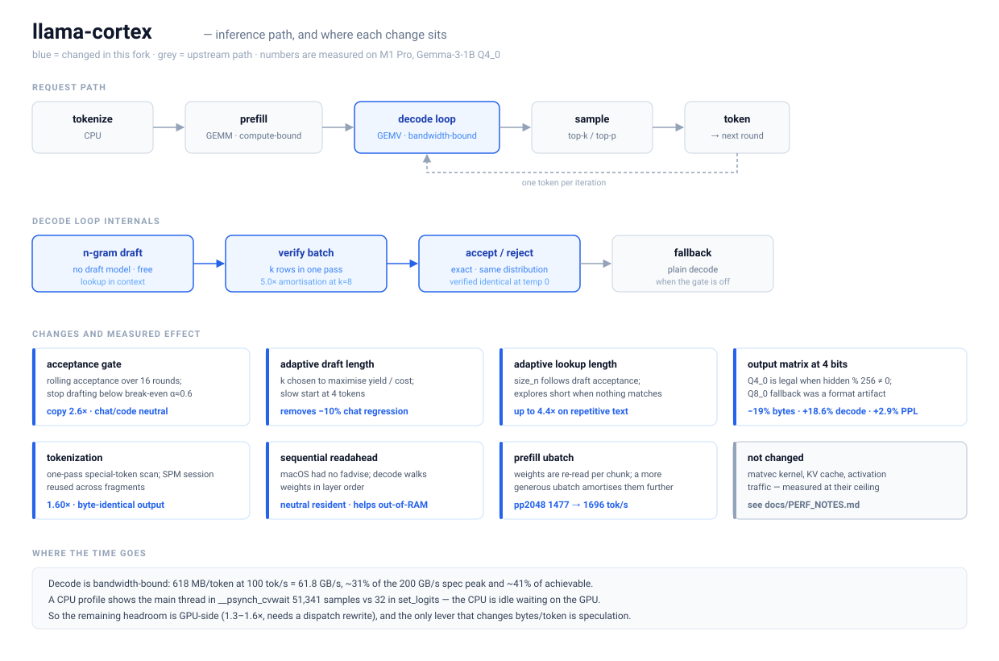

# llama-cortex

> A fork of [llama.cpp](https://github.com/ggml-org/llama.cpp) focused on
> inference performance. Same engine, same GGUF models, same API — with the
> hot paths reworked where the measurements said it was worth it.



## What changed

Every number below is measured on an M1 Pro (200 GB/s spec peak) with
Gemma-3-1B Q4_0, 120–150 generated tokens, unless noted. Nothing here is a
projection.

| change | effect | cost |
|---|---|---|
| **Gated n-gram speculation** — draft from the context, verify in one batch, stop when acceptance falls below break-even | **2.6× on copy/rewrite**, up to **4.4×** on repetitive text | none on chat/code (gate turns it off) |
| **Adaptive draft length** — pick `k` to maximise yield per unit of verification cost, slow-start at 4 | removes the −10% chat regression | — |
| **Adaptive lookup length** — `size_n` follows draft acceptance, explores short when nothing matches | 2.6× → 4.4× on repetitive text | — |
| **Output matrix at 4 bits** — Q4_0 is legal when `hidden % 256 ≠ 0`; the Q8_0 fallback was a format artifact, not a sensitivity result | **−19% bytes, +18.6% decode** | **+2.9% perplexity** |
| **Tokenization** — one-pass special-token scan, and stop rebuilding the SPM session per fragment | **1.60×** (0.91 s → 0.57 s per MB) | none, byte-identical output |
| **Sequential readahead** — macOS had no `fadvise`; decode walks weights in layer order | neutral when resident, helps when the model exceeds RAM | — |
| **Prefill ubatch** — weights are re-read per chunk | pp2048 1477 → 1696 tok/s | — |

Speculation is **exact**: verification preserves the target distribution, and
output was confirmed byte-identical at `--temp 0`.

## Quick start

```bash
cmake -B build -DCMAKE_BUILD_TYPE=Release -DGGML_METAL=ON
cmake --build build -j --target llama-cli llama-server

# interactive
./build/bin/llama-cortex-cli -m model.gguf

# OpenAI-compatible server
./build/bin/llama-cortex-server -m model.gguf -c 8192
```

Speculation is opt-in:

```bash
./build/bin/llama-cortex-cli -m model.gguf --spec-type ngram-simple
```

The gate and the adaptive length make it safe to leave on: it finds the
copy-heavy stretches of a workload and gets out of the way elsewhere.

## Where the time goes

Decode is bandwidth-bound. At 618 MB/token and 100 tok/s the engine moves
**61.8 GB/s** — about 31% of the 200 GB/s spec peak, and ~41% of what the
hardware actually sustains. That is the normal operating point for 4-bit
batch-1 decode on Apple GPUs, not an anomaly.

A CPU profile confirms it: the main thread sits in `__psynch_cvwait` for 51,341
samples against 32 in `set_logits`. **The CPU is idle waiting on the GPU**, so
CPU-side micro-optimisation cannot move this number.

That leaves two levers, and only one of them is large:

- **GPU-side efficiency** — the best hand-written native Metal runtime is
  1.15–1.56× ahead of llama.cpp, and its own paper attributes the win to
  dispatch overhead rather than faster matvec kernels. Closing it needs a
  dispatch rewrite.
- **Bytes per token** — speculation is the only lever that changes this rather
  than the efficiency of moving them, which is why it is worth more than any
  kernel tuning available here.

## Documentation

- **[docs/PERF_NOTES.md](docs/PERF_NOTES.md)** — the full measurement log,
  including the twelve approaches that were tried and did **not** work, with
  numbers. Read this before optimising anything here.
- [docs/OS_TUNING.md](docs/OS_TUNING.md) — the memory-hierarchy policy library
  (`cortex/`), a standalone analysis tool that is not wired into the inference
  path.

---

Everything below is upstream llama.cpp.


<div align="center">

<b>LLM inference in C/C++</b>

[](https://opensource.org/licenses/MIT)
[](https://github.com/ggml-org/llama.cpp/releases?q=tag:v0)
[](https://github.com/ggml-org/llama.cpp/releases?q=b)
[](https://github.com/ggml-org/llama.cpp/actions/workflows/server.yml)
[](https://github.com/ggml-org/llama.cpp/actions/workflows/docker.yml)
[](https://github.com/ggml-org/llama.cpp/actions/workflows/winget.yml)

[ggml](https://github.com/ggml-org/ggml) / [ops](https://github.com/ggml-org/llama.cpp/blob/master/docs/ops.md) / [maintainer PRs](https://github.com/ggml-org/llama.cpp/pulls?q=is%3Apr%20is%3Aopen%20draft%3AFalse%20(author%3Asanmai%20OR%20author%3Argerganov%20OR%20author%3AKitaitiMakoto%20OR%20author%3Adanbev%20OR%20author%3Aaldehir%20OR%20author%3Amax-krasnyansky%20OR%20author%3ACISC%20OR%20author%3Aggerganov%20OR%20author%3Aam17an%20OR%20author%3Ajhen0409%20OR%20author%3Abartowski1182%20OR%20author%3Anikwen%20OR%20author%3Ahipudding%20OR%20author%3Aravi9%20OR%20author%3AServeurpersoCom%20OR%20author%3Athelittlefireman%20OR%20author%3Apwilkin%20OR%20author%3Areeselevine%20OR%20author%3Angxson%20OR%20author%3Ajeffbolznv%20OR%20author%3Amarty1885%20OR%20author%3A0cc4m%20OR%20author%3ATitaniumtown%20OR%20author%3Aangt%20OR%20author%3AIMbackK%20OR%20author%3Aarthw%20OR%20author%3AJohannesGaessler%20OR%20author%3AORippler%20OR%20author%3Aruixiang63%20OR%20author%3Axctan%20OR%20author%3AmasterFoad%20OR%20author%3Aallozaur%20OR%20author%3AAndreas-Krebbel%20OR%20author%3Ayomaytk%20OR%20author%3Aaendk%20OR%20author%3Awine99%20OR%20author%3Agaugarg-nv%20OR%20author%3Ataronaeo%20OR%20author%3Aforforever73%20OR%20author%3Achaxu01%20OR%20author%3Alhez%20OR%20author%3AAlekseiNikiforovIBM%20OR%20author%3Anetrunnereve%20OR%20author%3Afairydreaming%20OR%20author%3Aynankani)%20sort%3Aupdated-desc) / [dev stats](https://github.com/ggml-org/llama.cpp-dev) / [lib llama API](https://github.com/ggml-org/llama.cpp/issues/9289) / [llama-server REST API](https://github.com/ggml-org/llama.cpp/issues/9291)

</div>

## Description

The main goal of `llama.cpp` is to enable LLM (and VLM) inference with minimal setup and state-of-the-art performance on
a wide range of hardware - locally and in the cloud.

- Plain C/C++ implementation without any dependencies
- Apple silicon is a first-class citizen - optimized via ARM NEON, Accelerate and Metal frameworks
- AVX, AVX2, AVX512 and AMX support for x86 architectures
- RVV, ZVFH, ZFH, ZICBOP and ZIHINTPAUSE support for RISC-V architectures
- 1.5-bit, 2-bit, 3-bit, 4-bit, 5-bit, 6-bit, and 8-bit integer quantization for faster inference and reduced memory use
- Custom CUDA kernels for running LLMs on NVIDIA GPUs (support for AMD GPUs via HIP and Moore Threads GPUs via MUSA)
- Vulkan and SYCL backend support
- CPU+GPU hybrid inference to partially accelerate models larger than the total VRAM capacity

The `llama.cpp` project is build on top of the [ggml](https://github.com/ggml-org/ggml) library.

## Supported backends

| Backend | Target devices |
| --- | --- |
| [BLAS](docs/build.md#blas-build) | All |
| [BLIS](docs/backend/BLIS.md) | All |
| [CANN](docs/build.md#cann) | Huawei Ascend NPU |
| [CUDA](docs/build.md#cuda) | Nvidia GPU |
| [HIP](docs/build.md#hip) | AMD GPU |
| [Hexagon](docs/backend/snapdragon/README.md) | Snapdragon |
| [IBM zDNN](docs/backend/zDNN.md) | IBM Z & LinuxONE |
| [MUSA](docs/build.md#musa) | Moore Threads GPU |
| [Metal](docs/build.md#metal-build) | Apple Silicon |
| [OpenCL](docs/backend/OPENCL.md) | Adreno GPU |
| [OpenVINO [In Progress]](docs/backend/OPENVINO.md) | Intel CPUs, GPUs, and NPUs |
| [RPC](https://github.com/ggml-org/llama.cpp/tree/master/tools/rpc) | All |
| [SYCL](docs/backend/SYCL.md) | Intel GPU |
| [VirtGPU](docs/backend/VirtGPU.md) | VirtGPU APIR |
| [Vulkan](docs/build.md#vulkan) | GPU |
| [WebGPU](docs/build.md#webgpu) | All |
| [ZenDNN](docs/backend/zendnn.md) | AMD CPU |

## Documentation

#### Tools

- [cli](tools/cli/README.md)
- [completion](tools/completion/README.md)
- [server](tools/server/README.md)
- [GBNF grammars](grammars/README.md)

#### Development

- [How to build](docs/build.md)
- [Running on Docker](docs/docker.md)
- [Build on Android](docs/android.md)
- [Multi-GPU usage](docs/multi-gpu.md)
- [Performance troubleshooting](docs/development/token_generation_performance_tips.md)
- [GGML tips & tricks](https://github.com/ggml-org/llama.cpp/wiki/GGML-Tips-&-Tricks)
- [XCFramework](docs/xcframework.md)
- [Completions](docs/completions.md)
- [Models](docs/models.md)
- [Release process](docs/release.md)

## Contributing

- Contributors can open PRs
- Collaborators will be invited based on contributions
- Maintainers can push to branches in the `llama.cpp` repo and merge PRs into the `master` branch
- Any help with managing issues, PRs and projects is very appreciated!
- Read the [CONTRIBUTING.md](CONTRIBUTING.md) for more information

## Acknowledgements

- [yhirose/cpp-httplib](https://github.com/yhirose/cpp-httplib) - Single-header HTTP server, used by `llama-server` - MIT license
- [nothings/stb](https://github.com/nothings/stb) - Single-header image format decoder, used by multimodal subsystem - Public domain
- [nlohmann/json](https://github.com/nlohmann/json) - Single-header JSON library, used by various tools/examples - MIT License
- [mackron/miniaudio](https://github.com/mackron/miniaudio) - Single-header audio format decoder, used by multimodal subsystem - Public domain
- [sheredom/subprocess.h](https://github.com/sheredom/subprocess.h) - Single-header process launching solution for C and C++ - Public domain
